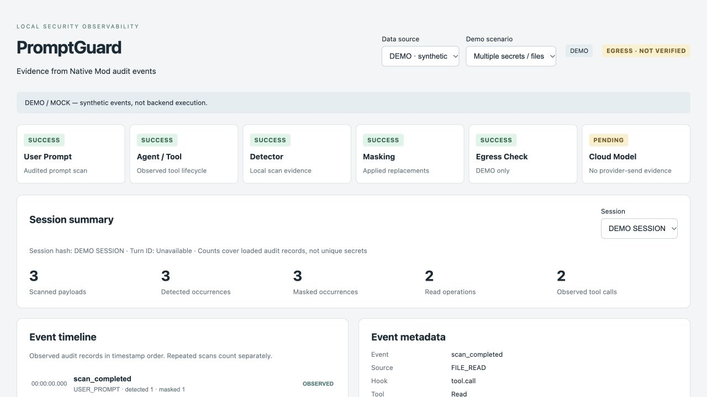

# PromptGuard Observability

## Existing repository analysis

The baseline checkout has no Web UI, frontend framework, package manifest, browser state store, or UI design system. Its user interface is the existing portable Claude CLI launcher. That launch flow remains in place.

- `src/native-mod/hooks/register.mjs` registers Claude Native Mod prompt/context/tool/history/subagent/compaction hooks. It recursively collects strings, calls MCP `scan_batch`, validates normalized spans, and rebuilds values with stable `[TYPE_n]` placeholders. Its in-memory ledger uses detector HMACs to reuse replacements.
- `src/detector/mcp-bridge.cjs` (moved from `src/credsweeper-adapter/` by the detector ensemble change) sends scan batches to a localhost Python worker. Raw strings must cross this existing internal detection boundary. They are not needed by observability.
- `src/detector/worker.py` (now a consensus ensemble of detector adapters configured in `src/detector/detector.json`; at the time of this analysis it ran CredSweeper alone) runs CredSweeper 1.19.0 with existing built-in/demo rules and returns canonical findings: type, UTF-16 start/end offsets, HMAC, confidence, rule ID, source, and per-scan detector/version/count/latency. No detector rules or masking policy changed.
- Existing JSON audit arrays contain timestamp, hashed session, source, finding/type/redacted counts, blocked flag, reason, latency and some hook/tool identifiers. No session/turn event bus exists. Turn IDs and file paths are not in the inspected hook/audit contract.
- `src/guard/server.cjs` is a validation-only mock provider endpoint. It scans complete received JSON and rejects failures/remaining findings; it does not forward requests to Anthropic. Existing `upstream_forwarded` records are mock behavior and are never treated as Cloud-send evidence by this UI.
- Prior tests are direct Python scripts: `tests/detector/test_normalize.py`, `tests/detector/run_detector_tests.py`, and optional detector microbenchmarks. There were no lint/typecheck/frontend build commands.
- Work started from a clean `main` checkout of `capstone-privai/promptguard-claude-demoV0`, with its existing origin retained. No user edits were overwritten. This is a checkout of the existing repository, not a replacement project.

## Minimal design and data flow

A dependency-free Node localhost server polls existing on-disk audit snapshots; vanilla browser modules render a safe DTO. There is no new agent, detector, proxy, framework, or production telemetry service.

```
Existing Native Mod → existing JSON audit → explicit DTO projection → local browser
Existing mock Guard record → separate validation-only card
UI-only synthetic scenarios → visibly labeled DEMO mode
```

Added audit fields: `event`, `operation` (local tool observation sequence, not Claude's tool ID), `scanned_payload_count`, `findings`, and `failure_stage`. Events are `scan_completed`, `scan_failed`, `tool_started`, `tool_failed`, and `tool_denied`. Tool scan completions retain the existing `tool.call` hook, with `tool.call.text` and `tool.call.context` identifying supplementary scans. Audit records for previously unreported history/context scans now cover those existing sanitization calls too.

Findings expose only detector, secret_type, rule_id, payload_index, start/end, offset_unit, action, and the already-applied placeholder. Rule metadata comes from the actual detector; no freeform explanation or AI reasoning is generated. Locations use zero-based UTF-16 offsets with exclusive ends, not guessed line numbers. Source mapping is explicit; automatic context/subagent ambiguity remains UNKNOWN.

Counts are occurrences across loaded scans, including repeated scans of the same secret. They are not deduplicated secret counts. A failed or legacy scan with missing counts makes totals unavailable. Tool counts correlate local `operation` IDs; legacy records remain independently observed results. Read operations do not establish distinct-file counts. File paths are not synthesized from tool names or payloads.

A failed Mod scan means the hook threw; it does not prove that Claude blocked provider transmission. Only the separate validation mock card may show SAFE/BLOCKED. SAFE requires an inspected, normal-mode mock request with zero remaining findings. Bypass, allow_raw, missing evidence, and positive remaining counts cannot produce SAFE. No event currently establishes real Cloud delivery.

## Security boundary

Raw prompt/tool/file text remains within existing Claude/Mod → MCP → detector memory boundaries. The hook strips raw text, hashes, arbitrary tool IDs/names and extra hook payload fields before writing audit. Arbitrary exception messages are replaced with fixed failure codes. Failure rows persist across subsequent successful writes (the baseline could lose them).

The browser API projects explicit fields and does not serialize entire audit records. Source/type/hook/tool/action/placeholder values are constrained; optional static detector rule labels are bounded and validated. It never returns raw_secret, full_raw_line, full_raw_prompt, value_hash, object paths, tool arguments, or input/output bodies. Audit files are trusted local application output, not a general-purpose untrusted import format.

Detector library logging is disabled because candidate text can occur in upstream diagnostics; explicit ready/health/error codes remain. Mock Guard evidence no longer persists request-derived message identifiers, raw JSON-key paths, or URL queries. Its detector/masking/forwarding decisions are unchanged.

The dashboard listens only on 127.0.0.1, rejects unexpected Host/Origin and non-GET requests, has a restrictive CSP, uses no-store responses, and serves an exact static file allowlist. It does not read Claude transcripts. No browser console logging or third-party telemetry is added.

Live previews show only `[DETECTED_SECRET]` versus the actual replacement token. They intentionally cannot prove surrounding structure preservation because retaining arbitrary sanitized payload text could still expose undetected secrets. Structure preservation is covered by hook regression tests. The non-secret localhost/port example is explicitly labeled DEMO and only shown with demo findings.

## Running

Node.js 22+:

```bash
node src/observability/server.mjs
# Open http://127.0.0.1:18880
```

Run the existing PromptGuard launcher separately. Default input is the lexically latest `mod-audit-*.json` in `.runtime/audit`. Override with:

- `PG_MOD_AUDIT`: exact audit JSON file (no client-supplied paths)
- `PG_AUDIT_DIR`: audit directory
- `PG_OBSERVABILITY_PORT`: localhost port, default 18880
- `PG_OBSERVABILITY_GUARD_RECORD`: optional exact `request-NNN.json` from the validation mock. This is displayed separately and is not correlated to the selected session.

PowerShell example: `$env:PG_MOD_AUDIT='C:\path\mod-audit.json'; node src/observability/server.mjs`.

Select DEMO to see zero secrets, prompt, file, tool, multiple findings, missing metadata, detector/sanitizer failures and blocked egress. Demo data contains only nonfunctional placeholder tokens and is never written to live audit. UI controls do not send credentials or invoke a Cloud model.

## Verification

```bash
npm ci --ignore-scripts
npm run lint
npm run typecheck
npm test
npm run build
.venv/bin/python tests/detector/test_normalize.py
.venv/bin/python tests/detector/run_detector_tests.py
```

Install the existing `requirements.txt` in `.venv` for the real worker integration test; otherwise that test explicitly skips. `PROMPTGUARD_PYTHON` can override the interpreter path. The integration test runs real CredSweeper, directly invokes existing Native Mod callbacks with synthetic fixture input, verifies safe audit and mock Guard SAFE/BLOCKED, stops the detector and verifies fail-closed behavior at the mock. It is not a Claude CLI or actual provider integration test.

DOM tests execute the actual app in jsdom, exercise all demo choices, assert no raw sentinel/null/undefined in rendered content, and intercept all console methods. HTTP tests cover safe projection, partial/malformed audit, Host/Origin rejection, and GET-only access. Hook tests check unchanged placeholder reuse, retained host/port structure, prompt/history/tool handling, failures, running states, and existing tool denial/transport bypass behavior.

Build verifies JavaScript syntax and copies the dependency-free app into `dist/observability`; no bundler is needed. Lint uses ESLint; typecheck uses TypeScript checkJs for all observability modules.

## Limits

- No authenticated Claude CLI is installed in the verification environment, so actual Claude/Cloud cases cannot be claimed. Hooks are exercised through a controlled test harness and real local detector.
- No real final model-bound verifier exists in this repository. The live top-level status remains NOT VERIFIED.
- Turn IDs, actual file paths, unique files, Cloud-send events, and full safe payload previews need upstream contracts before they can be displayed truthfully.
- At most the latest 2,000 audit records and 1,000 details per record are projected; the UI marks truncated history. Missing details are not treated as zero detections. Audit files over 16 MiB are rejected.
- Existing audit writes are full snapshots and may briefly be unreadable during a write; the UI clears stale data and retries. This work does not redesign persistence or introduce session retention.
- The browser is a local presentation surface; it cannot guarantee absence of secrets missed by the detector or in unrelated existing Claude logs/transcripts.

## Verified results (2026-10-11)

- `npm run lint`: PASS
- `npm run typecheck`: PASS (checkJs, observability modules)
- `npm test`: 14 PASS, 0 failures, 0 skips, including real CredSweeper/Mod/mock Guard integration
- `npm run build`: PASS
- Existing normalization script: 7/7 PASS
- Existing detector script: TP 32 / FP 0 / FN 0
- Browser: empty live state and all 9 DEMO choices checked; console entries 0
- No existing test failure was observed. An initial integration-test subprocess cleanup hang was fixed before the final passing run.
- Actual Claude CLI / provider requests were not executed.

Screenshots contain DEMO placeholders only:



[Full demo dashboard](screenshots/observability-demo.jpg) · [Mock blocked state](screenshots/observability-blocked.jpg)
